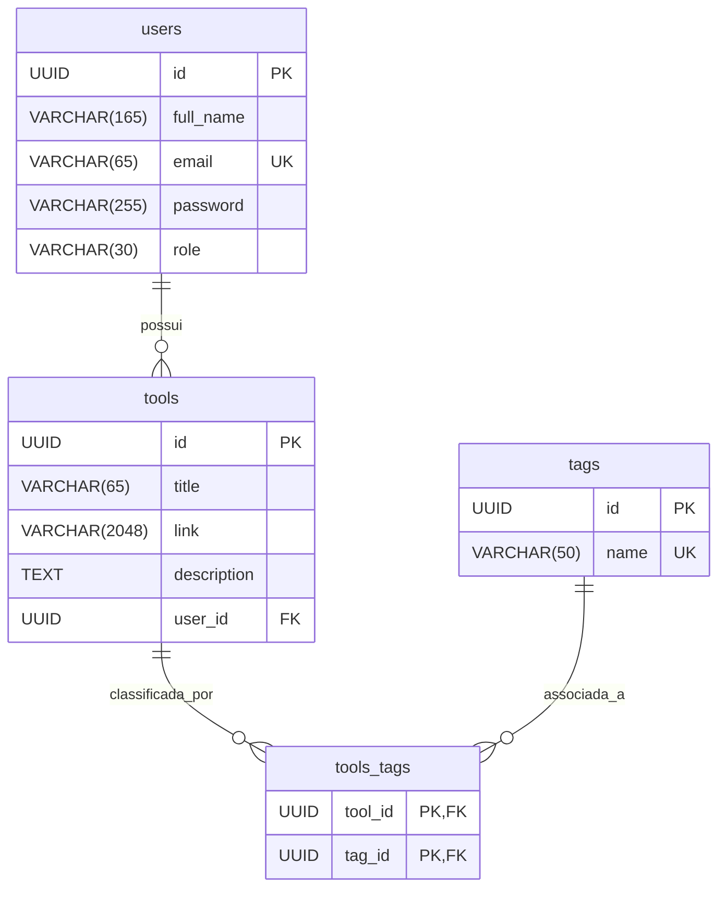

# Toolbox API
**API REST** para cadastrar e gerenciar ferramentas úteis, com nomes, links, descrições e tags. O projeto foi desenvolvido com **Java** e **Spring Boot**, com persistência em **PostgreSQL**.

A API permite criar e listar ferramentas, filtrar por tag e remover ferramentas. As rotas de ferramentas exigem autenticação por token **JWT**.

## Descrição
A Toolbox API permite:
- Cadastrar usuários e autenticar com e-mail e senha;
- Criar ferramentas com título, link, descrição e tags;
- Listar ferramentas cadastradas;
- Filtrar ferramentas por tag;
- Remover uma ferramenta pelo ID;
- Persistir dados em PostgreSQL com migrations gerenciadas pelo Flyway;
- Consultar e testar os endpoints pela interface Swagger.

## Sumário
- [Pré-requisitos](#pré-requisitos)
- [Como executar a aplicação](#como-executar-a-aplicação)
- [Documentação da API](#documentação-da-api)
- [Modelagem do banco de dados](#modelagem-do-banco-de-dados)
- [Rotas principais](#rotas-principais)
- [Tecnologias utilizadas](#tecnologias-utilizadas)
- [Decisões tomadas](#decisões-tomadas)
- [Observações](#observações)

## Pré-requisitos
- Docker Engine e Docker Compose v2 no Linux;
- Docker Desktop instalado e em execução no macOS;
- Docker Desktop instalado e em execução, com WSL 2 e integração habilitada, no Windows;
- Git, caso queira clonar o repositório.

## Como executar a aplicação
Na raiz do projeto, crie o arquivo `.env` a partir do exemplo:
```bash
cp .env.example .env
```

Edite `.env` e defina valores próprios para `SECRET_KEY`, `PG_PASSWORD` e `ADMIN_PASSWORD`. Os valores fornecidos no arquivo de exemplo são apenas para desenvolvimento e não devem ser usados em ambientes compartilhados ou de produção.

Inicie a aplicação e o banco de dados:
```bash
docker compose up --build -d
```

Acompanhe a inicialização da aplicação:
```bash
docker compose logs -f application
```

Quando a aplicação estiver iniciada, pressione `Ctrl+C` para encerrar o acompanhamento dos logs. Os containers continuarão em execução. A API estará disponível em `http://localhost:8080`.

Para parar os serviços sem remover os dados persistidos:
```bash
docker compose down
```

O PostgreSQL utiliza o volume Docker `toolbox_db_data`, que mantém os dados entre inicializações.

## Documentação da API
Com a aplicação em execução, acesse:
- Swagger UI: `http://localhost:8080/swagger-ui/index.html`
- Especificação OpenAPI em JSON: `http://localhost:8080/api-docs`

O Swagger descreve parâmetros, formatos de requisição e respostas, e permite testar os endpoints. Para acessar as rotas protegidas, informe no Swagger o token JWT retornado pelo login.

## Modelagem do banco de dados
O banco de dados utiliza quatro tabelas. Cada ferramenta pertence a um usuário, e ferramentas podem possuir várias tags. A tabela `tools_tags` representa o relacionamento muitos-para-muitos entre ferramentas e tags.



Os IDs são UUIDs gerados pela aplicação via JPA. O e-mail dos usuários e o nome de cada tag são únicos. As chaves estrangeiras de `tools_tags` formam uma chave primária composta e impedem a associação duplicada da mesma tag à mesma ferramenta. Ao remover um usuário ou ferramenta, as ferramentas relacionadas ou associações de tags são removidas em cascata.

## Rotas principais
| Método | Rota | Descrição | Autenticação |
|---|---|---|---|
| `POST` | `/auth/sign-up` | Cadastra um usuário (`fullName`, `email` e `password`) | Não |
| `POST` | `/auth/sign-in` | Autentica o usuário e retorna um token JWT | Não |
| `POST` | `/tools` | Cadastra uma ferramenta (`title`, `link`, `description` e `tags`) | JWT |
| `GET` | `/tools` | Lista ferramentas; aceita o parâmetro opcional `tag` | JWT |
| `DELETE` | `/tools/{toolId}` | Remove uma ferramenta pelo UUID | JWT |

O token JWT tem validade de duas horas. O cadastro de ferramenta responde com `201 Created`; a remoção responde com `204 No Content`.

## Tecnologias utilizadas
- **Java 21** - Linguagem de programação;
- **Spring Boot 4.0.8** - Framework da aplicação;
- **Spring Web MVC** - Criação das rotas REST;
- **Spring Data JPA** - Persistência e acesso aos dados;
- **Spring Security** - Autenticação e autorização;
- **JWT (java-jwt)** - Emissão e validação dos tokens;
- **PostgreSQL 17** - Banco de dados relacional;
- **Flyway** - Versionamento e migrations do banco de dados;
- **Maven** - Gerenciamento e build do projeto;
- **Docker e Docker Compose** - Containerização e execução dos serviços;
- **Springdoc OpenAPI / Swagger UI** - Documentação interativa da API;
- **Lombok** - Redução de código boilerplate.

## Decisões tomadas
### Armazenamento de tags
Optei por armazenar as tags em uma tabela própria e relacioná-las às ferramentas por meio de uma relação muitos-para-muitos (N:N). Assim, se for necessário alterar uma tag, basta atualizar seu registro na tabela `tags`. Se elas fossem armazenadas em uma coluna `TEXT[]` na tabela de ferramentas, seria preciso atualizar todos os registros que contivessem a tag. Por outro lado, com a abordagem adotada, ao cadastrar uma ferramenta é necessário verificar se cada tag já existe no banco, o que pode aumentar o número de consultas.

## Observações
- Os dados do PostgreSQL são persistidos no volume Docker `toolbox_db_data`;
- A documentação detalhada dos endpoints está disponível no **Swagger**;
- A listagem sem `tag` retorna todas as ferramentas; ao informar `tag`, a busca considera as ferramentas do usuário autenticado.
- Este projeto pessoal foi fortemente inspirado no desafio técnico da empresa **Bossabox**;
- Na raiz do projeto, há a pasta `postman` que inclui a coleção de requisições. Você pode importar no Postman para fazer as requisições de maneira mais fácil.
